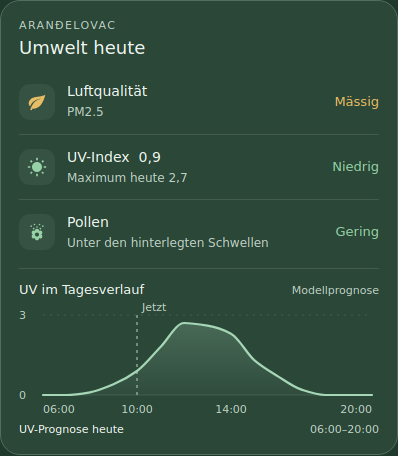

# Umweltkarte für Home Assistant

**Luftqualität, UV und Pollen in lesbaren Zeilen** – mit einer kompakten UV-Tagesprognose darunter. Jede Zeile öffnet beim Antippen die zugehörigen Sensordetails. Die Darstellung folgt dem vorhandenen Home-Assistant-Theme.



*Beispieldaten und grünes HA-Theme. Die tatsächlichen Farben kommen aus deinem Theme.*

Die Karte nutzt bestehende Sensoren. Sie erstellt keine neuen Entitäten und fragt keine externen Dienste ab. Mushroom, ApexCharts und card-mod sind für diese Karte nicht erforderlich.

## Installation mit HACS

1. HACS öffnen → Menü mit den drei Punkten → **Benutzerdefinierte Repositories**.
2. `https://github.com/AshenSage/ha-umweltkarte` hinzufügen.
3. Als Typ **Dashboard** auswählen und **Umweltkarte** herunterladen.
4. Home Assistant im Browser bzw. die App vollständig neu laden.
5. Den bisherigen gesamten `vertical-stack` aus den drei Umweltkacheln und der UV-Grafik durch die folgende einzelne Karte ersetzen.

```yaml
type: custom:ha-umweltkarte
title: Umwelt heute
subtitle: Aranđelovac
air_entity: sensor.arandjelovac_luftqualitaet
uv_entity: sensor.arandjelovac_uv_index
pollen_entity: sensor.arandjelovac_pollen
show_uv_chart: true
grid_options:
  columns: 12
  rows: auto
```

Die YAML gehört in den **Karteneditor des Dashboards**, nicht in `configuration.yaml`. Das Beispiel liegt auch unter [`examples/arandjelovac.yaml`](examples/arandjelovac.yaml).

Falls HACS die Ressource nicht automatisch angelegt hat, unter **Einstellungen → Dashboards → Ressourcen** als **JavaScript-Modul** eintragen:

```yaml
url: /hacsfiles/ha-umweltkarte/ha-umweltkarte.js
type: module
```

Den Ressourceneintrag nur einmal anlegen. Die bisherigen Sensoren bleiben bestehen. Die alte Karten-YAML muss ersetzt werden, damit das neue Layout angezeigt wird.

## Einstellungen

| Option | Standard | Bedeutung |
| --- | --- | --- |
| `title` | `Umwelt heute` | Überschrift; leerer Text blendet sie aus. |
| `subtitle` | `Aranđelovac` | Ortsname über der Überschrift; leerer Text blendet ihn aus. |
| `air_entity` | `sensor.arandjelovac_luftqualitaet` | Vorhandener Luftqualitätssensor. |
| `uv_entity` | `sensor.arandjelovac_uv_index` | Vorhandener UV-Sensor mit Tagesprognose. |
| `pollen_entity` | `sensor.arandjelovac_pollen` | Vorhandener Pollensensor. |
| `show_uv_chart` | `true` | Mit `false` nur die drei Zeilen anzeigen. |
| `time_zone` | HA-Einstellung | Optionale Zeitzone, z. B. `Europe/Belgrade`; Fallback bei fehlender HA-Einstellung ebenfalls Belgrad. |

Voraussetzung: Home Assistant ab 2026.10.0 und Sensoren mit dem unten beschriebenen Datenformat. Für andere Orte können passende Sensoren eingetragen werden.

## Bedienung

- **Luftqualität, UV oder Pollen antippen:** Home-Assistant-Sensordetails öffnen.
- **UV-Grafik berühren oder mit der Maus erkunden:** Uhrzeit und UV-Stundenprognose erscheinen unter der Kurve.
- Die Grafik mit der Tastatur fokussieren: **Pfeil links/rechts**, **Home** und **End** wählen Stundenwerte; **Escape** setzt die Auswahl zurück.
- Die gestrichelte **Jetzt**-Linie zeigt die aktuelle Uhrzeit innerhalb von 06:00–20:00. Die Kurve ist eine **Modellprognose**, keine Messwert-Historie.
- Alle Beschriftungen und Warnhinweise umbrechen auf schmalen Displays. Es gibt keine horizontale Scrollleiste.

## Datenstatus und Farben

- Ein Sensorzustand wird nur verwendet, wenn er vorhanden ist und das Attribut `quelle_aktuell` tatsächlich `true` ist.
- Ohne aktuellen Wert erscheint `—` mit `datenstatus` oder einem passenden Hinweis. Solche Zustände erhalten eine neutrale Farbe.
- Luftqualität zeigt den Sensorzustand und `grund` unverändert inhaltlich an.
- UV zeigt den aktuellen Index, die Stufe und – falls numerisch vorhanden – `max_heute`; auch UV 0 ist ein gültiger Wert.
- UV-Farben: unter 3 grün, unter 6 gelb/amber, unter 8 orange, unter 11 rot, ab 11 violett.
- Bei Pollen bleiben `grund` sowie die Vollständigkeit der Daten sichtbar. Ein als gering gemeldeter Wert aus unvollständigen Daten erhält keine grüne Entwarnungsfarbe.
- Bei Abbruch der HA-Verbindung blendet die Karte Zustandswerte und Prognose aus. Nach Wiederverbindung werden die aktuellen Zustände erneut verwendet.
- Die Karte prüft die Zeit minütlich neu, auch wenn gerade kein Sensorupdate eintrifft.

Für Luft- und Pollendaten bleibt `quelle_aktuell` die massgebliche Aktualitätsprüfung des vorhandenen Sensors. Die Karte berechnet diese beiden Qualitätsstufen nicht selbst neu. Wenn sich die Datenquelle ändert, muss der jeweilige Sensor seinen Quellenstatus weiterhin korrekt führen.

## Benötigte Sensorattribute

### Luftqualität

Zustand z. B. `Gut`, `Akzeptabel`, `Mässig`, `Schlecht`, `Sehr schlecht` oder `Extrem schlecht`.

```yaml
quelle_aktuell: true
grund: PM2.5
datenstatus: Aktuell
```

### UV

Zustand: numerischer UV-Index. Formatbeispiel, keine aktuellen Wetterdaten:

```yaml
quelle_aktuell: true
stufe: Niedrig
max_heute: 2.7
prognose_datum: '2026-10-15'
datenzeit: '2026-10-15T10:00:00+02:00'
empfangen: '2026-10-15T10:02:00+02:00'
prognose_status: Verfügbar
stunden_heute:
  - [1792036800000, 0.0]
  - [1792040400000, 0.1]
  - [1792044000000, null]
```

`stunden_heute` enthält `[UTC-Zeitstempel in Millisekunden, UV-Wert oder null]`. Die Zeitstempel werden **nicht erneut um einen Zeitzonenoffset verschoben**. Die Beispieldaten illustrieren das Format; der Sensor liefert die echte vollständige Tagesprognose.

Die Grafik wird nur gezeigt, wenn:

- der Sensor einen gültigen, nicht negativen Index und `quelle_aktuell: true` liefert;
- `prognose_datum` dem heutigen Tag in der HA-Zeitzone entspricht;
- `datenzeit` höchstens **2 Stunden** zurückliegt und maximal **5 Minuten** in der Zukunft liegt;
- `empfangen` höchstens **90 Minuten** zurückliegt und maximal **1 Minute** in der Zukunft liegt;
- Zeitangaben einen eindeutigen Zeitzonenoffset oder `Z` haben;
- mindestens ein gültiger Stundenwert zwischen 06:00 und 20:00 vorhanden ist.

Fehlende, negative, nicht numerische und `null`-Stundenwerte bleiben Lücken. Auch fehlende Zeitabschnitte von mehr als 90 Minuten werden nicht durch eine Linie überbrückt. Einzelne gültige Werte erscheinen als Punkt. Sommer- und Winterzeit werden über die HA-Zeitzone berücksichtigt.

### Pollen

Zustand z. B. `Gering`, `Mässig`, `Stark`, `Mindestens Mässig`, `Mindestens Stark` oder `Keine Pollen gemeldet`.

```yaml
quelle_aktuell: true
grund: ''
vollstaendig: true
arten_vorhanden: 6
arten_erwartet: 6
```

Bei fehlender Vollständigkeitsangabe behandelt die Karte die Daten als unvollständig. Erwartete/vorhandene Arten werden nur als Zahlen angezeigt, wenn beide Angaben gültig sind.

## Theme und Farben

Die Karte übernimmt Kartenhintergrund, Text, Rahmen, Rundungen und Statusfarben aus Home Assistant. Optional können Themes eigene Variablen setzen:

```yaml
umweltkarte-chart-color: '#91d1a4'
umweltkarte-good-color: '#8dcd9d'
umweltkarte-moderate-color: '#e6b860'
```

Weitere optionale Variablen: `umweltkarte-acceptable-color`, `umweltkarte-high-color`, `umweltkarte-very-high-color` und `umweltkarte-extreme-color`.

## Updates

Neue stabile Releases werden über HACS angeboten. Nach dem Update den Browser bzw. die App vollständig neu laden. Die Ressourcen-URL und Karten-YAML können bestehen bleiben.

## Manuelle Installation

`dist/ha-umweltkarte.js` nach `/config/www/ha-umweltkarte.js` kopieren und `/local/ha-umweltkarte.js?v=1.0.0` als JavaScript-Modul registrieren. Anschliessend die Karten-YAML wie oben verwenden.

## Entwicklung und Veröffentlichung

Die ausgelieferte Karte besteht aus einer einzigen Datei: `dist/ha-umweltkarte.js`. Es gibt keine Build- oder Laufzeit-Abhängigkeiten.

```bash
npm run check
```

Die Prüfungen decken Datenstatus, UV-Schwellen, unvollständige Pollendaten, Prognosealter, ungültige Werte, Datenlücken und Zeitzonen inklusive Zeitumstellung ab.

Für neue Versionen `VERSION` in der JavaScript-Datei, `package.json`, `CHANGELOG.md` und `RELEASE_NOTES.md` aktualisieren. Der Workflow veröffentlicht nach bestandenem Check eine neue **stabile** GitHub-Release-Version mit der JavaScript-Datei als Download. Vorab-Versionen sind ausgeschlossen.

Die erste Version wurde zusätzlich lokal in einem Browser mit simulierten HA-Zuständen geprüft: 320, 375, 430 und 768 Pixel Breite, helles und dunkles Theme, Sensordetails, Maus-/Tastaturbedienung, Verbindungsausfall, Wiederverbindung, Datenlücken und Ablauf der UV-Prognose. Auf einem laufenden Home-Assistant-Server wurde die Karte noch nicht ausgeführt.

## Referenzen

- [Home Assistant: eigene Dashboard-Karten](https://developers.home-assistant.io/docs/frontend/custom-ui/custom-card/)
- [HACS: Dashboard-Repositories](https://www.hacs.dev/docs/publish/plugin/)
